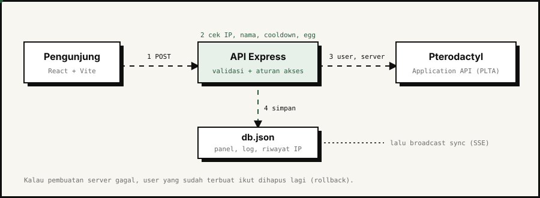

<p align="center">
  
</p>

<p align="center">
  
  
  
  
  
  
</p>

FreePanel adalah web untuk membagikan panel [Pterodactyl](https://pterodactyl.io) secara gratis tanpa admin harus membuatkan satu per satu. Pengunjung cukup mengisi satu nama dan memilih egg, lalu sistem membuat akun dan server di Pterodactyl lewat API, dan data loginnya langsung ditampilkan. Tidak ada form daftar, tidak ada login untuk pengguna biasa.

Biasanya dipakai untuk membagi slot hosting bot WhatsApp, Telegram, atau Discord. Supaya slot tidak habis diambil satu orang, tiap IP hanya boleh punya satu panel, dan panel bisa dibatasi dengan masa trial yang dihapus otomatis saat habis.

## Cara kerjanya

<p align="center">
  
</p>

1. Pengunjung mengirim nama dan egg ke `POST /api/panel/create`.
2. Backend mengecek semuanya sebelum menyentuh Pterodactyl: pembuatan sedang dibuka atau tidak, format nama (4 sampai 16 karakter, huruf kecil dan angka), IP sudah punya panel atau belum, IP kena blacklist atau cooldown, nama sudah dipakai atau belum, dan egg yang dipilih memang diizinkan.
3. Backend membuat user di Pterodactyl, lalu membuat server dengan resource sesuai pengaturan admin. Kalau pembuatan server gagal, user yang sudah terlanjur dibuat dihapus lagi supaya tidak ada akun yatim.
4. Data panel disimpan ke `db.json`, lalu semua browser yang sedang terbuka diberi sinyal untuk memuat ulang data (Server-Sent Events).
5. Pengunjung menerima username, password, email, dan domain panel, plus tombol salin semua.

Pengguna tidak punya akun di FreePanel. Panel mereka dikenali dari IP, jadi halaman "Panel saya" langsung menampilkan panel milik IP yang sedang dipakai.

## Fitur

**Untuk pengguna**

- Claim panel tanpa daftar. Nama dibersihkan otomatis (huruf besar diturunkan, simbol dibuang) dan email serta pola password ditampilkan sebelum tombol ditekan.
- Password dibuat otomatis dari nama ditambah 4 karakter acak, tanpa karakter yang gampang tertukar (0, 1, I, O).
- Halaman "Panel saya": data akun, hitung mundur masa trial, dan status server langsung dari Pterodactyl (state, CPU, RAM, disk).
- Minta perpanjangan masa aktif dengan alasan opsional. Jawaban admin (disetujui atau ditolak beserta alasannya) muncul di halaman yang sama dan di notifikasi.
- Notifikasi dari admin dengan penanda belum dibaca, termasuk banner yang disematkan di atas halaman.
- Tema terang dan gelap, tampilan responsif untuk HP.

**Untuk admin**

- Konfigurasi lengkap dari dashboard, tanpa edit file: domain panel, API key, daftar egg, resource per panel, masa trial, cooldown, rules, dan tombol buka tutup pembuatan panel.
- Tes koneksi ke Pterodactyl yang mengecek kedua API key dan menghitung egg yang terbaca.
- Daftar panel dengan pencarian, filter status (aktif, hampir habis, kadaluarsa, permanen, minta perpanjang), detail kredensial, perpanjang 7 atau 30 hari, jadikan permanen, cek status server, dan hapus.
- Setujui atau tolak permintaan perpanjangan dengan jumlah hari dan alasan sendiri.
- Kirim notifikasi ke semua pengguna atau ke satu IP saja, dengan jenis info, update, promo, atau penting.
- Blacklist IP, lihat riwayat claim per IP, dan reset cooldown.
- Log aktivitas (pembuatan, kedaluwarsa, permintaan, perubahan konfigurasi, login admin, error) hingga 500 entri terakhir.

## Aturan akses dan masa aktif

Dua angka di konfigurasi menentukan perilaku claim: **masa trial** dan **cooldown**.

| Pengaturan | Nilai | Artinya |
| --- | --- | --- |
| Masa trial (hari) | `0` | Panel baru tidak punya batas waktu |
| | `7` (default) | Panel dihapus otomatis 7 hari setelah dibuat |
| Cooldown claim ulang (hari) | `0` | Boleh claim lagi langsung setelah panel berakhir atau dihapus |
| | `30` (default) | Boleh claim lagi 30 hari setelah panel berakhir |
| | `-1` | Satu IP hanya boleh claim sekali seumur hidup |

Cooldown dihitung sejak panel berakhir atau dihapus admin, bukan sejak dibuat. Admin bisa mereset cooldown satu IP dari tab Akses.

Sweeper berjalan tiap satu menit di backend. Panel yang sisa waktunya kurang dari 24 jam dikirimi notifikasi peringatan sekali, dan panel yang sudah lewat waktu dihapus dari Pterodactyl beserta user-nya. Kalau penghapusan gagal (misalnya Pterodactyl sedang mati), panel tetap tercatat dan dicoba lagi di putaran berikutnya, dan error hanya dicatat sekali supaya log tidak penuh.

## Stack

### Frontend

| Bagian | Yang dipakai |
| --- | --- |
| Framework | React 18 (JSX, tanpa TypeScript) |
| Build tool | Vite 5 dengan `@vitejs/plugin-react` |
| Routing | Router buatan sendiri berbasis `history.pushState`, tanpa library |
| Styling | Satu file CSS dengan CSS variables, tanpa framework CSS |
| Font | Inter dan JetBrains Mono dari Google Fonts |
| Ikon | SVG inline lewat komponen `Icon`, tanpa library ikon dan tanpa emoji |
| Data realtime | `EventSource` ke `/api/stream`, di-debounce 250 ms |
| State | `useState` dan `useEffect` biasa, tanpa state manager |

Dependensi runtime frontend hanya `react` dan `react-dom`. Sengaja dibuat tipis supaya mudah dibaca dan hasil build kecil (sekitar 60 kB gzip untuk JavaScript).

Halaman yang tersedia:

| Rute | Isi |
| --- | --- |
| `/` | Landing: hero dengan cuplikan log, fitur, cara kerja, FAQ |
| `/claim` | Form buat panel dan layar hasil dengan tombol salin |
| `/panel-saya` | Data panel, hitung mundur, status server, form minta perpanjangan |
| `/notifikasi` | Daftar pesan dari admin |
| `/admin` | Dashboard dengan lima tab: Konfigurasi, Panel, Notifikasi, Akses, Log |

Halaman yang berubah dari sisi server (daftar panel, notifikasi, status claim) tidak perlu di-refresh manual. Backend mengirim event `sync` lewat SSE setiap data berubah, dan frontend memuat ulang data yang relevan. Saat tab browser kembali aktif atau koneksi tersambung ulang, data juga dimuat ulang.

### Backend

| Bagian | Yang dipakai |
| --- | --- |
| Runtime | Node.js 18+ (ES Modules, `fetch` bawaan) |
| Framework | Express 4 |
| Autentikasi admin | `jsonwebtoken` (JWT, berlaku 12 jam) |
| Konfigurasi | `dotenv` |
| CORS | `cors` |
| Penyimpanan | File JSON (`server/data/db.json`), tanpa database server |
| Push ke browser | Server-Sent Events |
| Integrasi | REST API Pterodactyl v1 (Application API dan Client API) |

Hanya empat dependensi: `express`, `cors`, `dotenv`, dan `jsonwebtoken`.

**Integrasi Pterodactyl.** Backend memakai dua jenis API key. PLTA (Application API) dipakai untuk membaca nest dan egg, membuat user, membuat server, dan menghapus keduanya. PLTC (Client API) hanya dipakai untuk membaca status server (state, CPU, memori, disk) dan hasilnya di-cache 30 detik. Semua request ke Pterodactyl punya batas waktu 25 detik, dan error dari Pterodactyl dipetakan ke pesan yang bisa dipahami pengguna.

**Penyimpanan.** Semua data (pengaturan, panel, log, notifikasi, riwayat IP, blacklist) ada di satu file JSON. Setiap penyimpanan ditulis ke file sementara dulu lalu di-rename, jadi file tidak rusak setengah jalan kalau proses mati di tengah penulisan.

**Keamanan.**

- Login admin memakai perbandingan waktu konstan dan dibatasi 5 percobaan per 10 menit per IP.
- API key Pterodactyl yang tersimpan tidak pernah dikirim balik ke browser utuh, hanya petunjuk beberapa karakter terakhir.
- Satu IP tidak bisa mengirim dua permintaan claim bersamaan (permintaan kedua ditolak selama yang pertama diproses).
- Body request dibatasi 100 kB, dan input nama divalidasi dengan pola ketat sebelum dipakai.
- Kalau `JWT_SECRET` atau `ADMIN_PASS` belum diisi, server memberi peringatan di log saat menyala.

**Endpoint.**

| Kelompok | Endpoint | Fungsi |
| --- | --- | --- |
| Publik | `GET /api/stream` | Aliran SSE untuk sinyal sinkronisasi |
| | `GET /api/public/info` | Info claim: dibuka atau tidak, daftar egg, trial, status blokir untuk IP ini |
| | `GET /api/public/notifications` | Notifikasi untuk semua dan untuk IP ini |
| | `POST /api/panel/create` | Buat panel |
| Per IP | `GET /api/me` | Data panel milik IP ini |
| | `GET /api/me/status` | Status server dari Pterodactyl |
| | `POST /api/me/extend` | Minta perpanjangan |
| | `POST /api/me/extend/dismiss` | Tutup hasil permintaan perpanjangan |
| Admin | `POST /api/admin/login` | Login, mengembalikan JWT |
| | `GET`, `PUT /api/admin/settings` | Baca dan simpan konfigurasi |
| | `POST /api/admin/test` | Tes koneksi PLTA dan PLTC |
| | `GET /api/admin/panels` | Daftar panel |
| | `GET /api/admin/panels/:id/status` | Status server satu panel |
| | `POST /api/admin/panels/:id/extend` | Perpanjang atau jadikan permanen |
| | `POST /api/admin/panels/:id/request` | Setujui atau tolak permintaan perpanjangan |
| | `DELETE /api/admin/panels/:id` | Hapus panel dan user dari Pterodactyl |
| | `POST /api/admin/sweep` | Jalankan sweeper sekarang |
| | `GET`, `POST`, `PUT`, `DELETE /api/admin/notifs` | Kelola notifikasi |
| | `GET /api/admin/access`, `POST`, `DELETE /api/admin/blacklist`, `DELETE /api/admin/history` | Blacklist dan riwayat claim |
| | `GET`, `DELETE /api/admin/logs` | Lihat dan bersihkan log |

Semua endpoint `/api/admin/*` kecuali login butuh header `Authorization: Bearer <token>`.

## Instalasi

Yang dibutuhkan: Node.js 18 atau lebih baru, dan satu panel Pterodactyl yang sudah jalan dengan minimal satu node yang punya allocation (port) kosong di location yang akan dipakai.

```bash
git clone https://github.com/momonpxlv1/create-panel-trial.git
cd create-panel-trial
npm run install:all
cp server/.env.example server/.env
```

Edit `server/.env`:

| Key | Fungsi |
| --- | --- |
| `PORT` | Port server, default `3001` |
| `ADMIN_USER` | Username login admin, default `admin` |
| `ADMIN_PASS` | Password login admin. Wajib diganti |
| `JWT_SECRET` | String acak yang panjang untuk menandatangani token admin. Kalau kosong, token hilang tiap server restart |

Mode produksi (frontend dibuild lalu disajikan oleh Express):

```bash
npm run build
npm start
```

Mode pengembangan (dua terminal, Vite mem-proxy `/api` ke `localhost:3001`):

```bash
cd server && npm run dev
cd client && npm run dev
```

### Konfigurasi pertama kali

Halaman admin tidak punya tombol di navigasi. Klik logo di pojok kiri atas **lima kali berturut-turut** (jeda antar klik kurang dari dua detik) untuk memunculkan form login admin.

Setelah masuk, buka tab **Konfigurasi** dan isi berurutan:

1. **Domain panel**: alamat panel Pterodactyl kamu, misalnya `https://panel.domainmu.com`.
2. **PLTA**: Application API key dari panel (Admin, Application API). Beri akses baca dan tulis untuk Users dan Servers, serta baca untuk Nests dan Eggs.
3. **PLTC**: Client API key dari akun admin panel (Account, API Credentials). Hanya dipakai untuk membaca status server.
4. Tekan **Tes koneksi**. Kalau berhasil, kedua key menampilkan OK dan jumlah egg yang terbaca.
5. **ID Location**: ID location di Pterodactyl tempat server akan dibuat.
6. **Egg**: daftar egg yang ditawarkan ke pengguna (ID dan nama tampilan), egg default, dan apakah semua egg dari panel ikut ditampilkan.
7. **Resource per panel**: RAM, disk, CPU, swap, IO, jumlah database, backup, dan allocation. Default-nya 1024 MB RAM, 1024 MB disk, 100% CPU.
8. **Trial dan cooldown**, lalu **rules** yang tampil di hasil claim.
9. Simpan, dan nyalakan **Pembuatan panel dibuka**.

## Yang perlu kamu tahu sebelum deploy

Beberapa hal ini bukan bug, tapi konsekuensi dari desainnya:

- **Pembatasan berbasis IP bisa dilewati** dengan VPN atau ganti jaringan. Untuk layanan gratis ini cukup, tapi jangan anggap sebagai pengaman mutlak.
- **IP dibaca dari header proxy** (`cf-connecting-ip`, lalu `x-forwarded-for`). Jalankan di belakang Cloudflare atau Nginx dan jangan buka port server langsung ke internet, karena kalau tidak, header itu bisa dipalsukan orang dan aturan satu IP satu panel jadi tidak berlaku.
- **Password panel disimpan apa adanya** di `db.json` supaya admin bisa melihatnya di detail panel. Lindungi file itu, jangan di-commit (sudah ada di `.gitignore`), dan batasi akses ke server.
- **Penyimpanan JSON cocok untuk satu proses saja.** Jangan jalankan beberapa instance sekaligus, dan siapkan backup berkala untuk `server/data/db.json`.
- Batas percobaan login admin disimpan di memori, jadi hilang saat server restart.

## Kontribusi

Menemukan bug atau punya perbaikan? Silakan buka issue atau kirim pull request. Sertakan langkah untuk mereproduksi masalahnya kalau melaporkan bug, dan jangan sertakan file `.env` atau isi `db.json` di issue.

## Credit

```
Creator : momonpxl
Sosmed  : Instagram & TikTok -> @momonpxl
Join Channel WhatsApp admin : https://whatsapp.com/channel/0029VbDYUWf8qIzlSl4slR0t

Jangan hapus credit dari Developer, hargailah Dev.
Kalau kalian menemukan bug, silakan pull request ya.
Waktu yang Mimin habiskan untuk mengembangkan : 4 hari + 19 jam

Special thanks for my friend : Hideaki
```

## Lisensi

[MIT](LICENSE). Boleh dipakai dan dimodifikasi, dengan syarat copyright notice dan credit header di file sumber tetap dipertahankan.